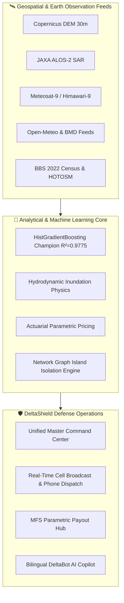

# 🛡️ DeltaShield™: Unified National Climate Risk & Urban Flood Intelligence Platform

<p align="center">
  
  
  
  
  
  
</p>

---

## 📖 Executive Summary

**DeltaShield™** is an institutional-grade, multi-hazard climate intelligence and operational decision-support platform engineered for Bangladesh. 

Grounded in **49 geospatial layers** (Copernicus DEM 30m, JRC Global Surface Water, JAXA ALOS-2 SAR, NASA EarthData, HOTOSM road networks, BBS national census figures, and 2030–2050 CMIP6 climate projection scenarios), the platform fuses multi-spectral satellite thermal scanning, hydrodynamic flood models, and machine learning into an interactive civil defense command suite.

---

## 🌐 Instant Web Access & GitHub Pages Hosting

DeltaShield is designed with zero mandatory server dependencies—the frontend runs entirely on modern client-side standards (HTML5 Canvas, Vanilla CSS3, Leaflet GIS, and Chart.js).

### Host Directly on GitHub Pages (1-Click Deployment)
1. Fork or push this repository to GitHub.
2. Go to **Settings** → **Pages**.
3. Under **Build and deployment** > **Source**, choose **GitHub Actions** (or select **Deploy from a branch** → Branch: `main` / Folder: `/ (root)`).
4. DeltaShield will immediately be accessible live at:
   ```
   https://<your-username>.github.io/<your-repo-name>/
   ```
   *(The root `index.html` automatically routes visitors to the Command Center).*

---

## 🏛️ The 16 Specialized Defense Suites

| # | Pillar / Application | Dedicated Route | Core Operational Capability | Target Stakeholder |
| :-: | :--- | :--- | :--- | :--- |
| **01** | **🛰️ Weather AI & Satellite** | [`web/weather_ai.html`](web/weather_ai.html) | Meteosat-9/Himawari-9 10.4µm IR thermal radar, Doppler cloud vector, and 20D/60D predictive synoptic AI. | BMD, Civil Aviation, Port Authorities |
| **02** | **🚨 Disaster Alerts & Siren** | [`web/disaster_alerts.html`](web/disaster_alerts.html) | Acoustic sirens, automated telephone voice calls, and SMS Cell Broadcast (CBS-4370) engine. | MoDMR, Red Crescent, Media |
| **03** | **🌾 AgroClaim Insurance** | [`web/agroclaim.html`](web/agroclaim.html) | Sentinel-1 SAR radar crop submersion detection and instant bKash/Nagad mobile parametric payouts. | MFS (bKash/Nagad), Insurers, DAE |
| **04** | **🏛️ 64-District Directory** | [`web/district_heritage.html`](web/district_heritage.html) | Comprehensive dossiers on BWDB embankments, heritage landmarks, sluice gates, and cyclone shelters. | Archeology Dept, Local Govt, BWDB |
| **05** | **📋 Executive SitRep** | [`web/executive_sitrep.html`](web/executive_sitrep.html) | Official Cabinet Disaster Situation Report with live river basin alerts, casualty numbers, and print-ready PDF export. | Prime Minister's Office, Cabinet Division |
| **06** | **🤖 DeltaBot AI Copilot** | [`web/deltabot.html`](web/deltabot.html) | Bilingual (English/Bangla) natural language disaster copilot with localized emergency instructions. | Citizens, Field Volunteers |
| **07** | **🗺️ GIS Tactical GPS Map** | [`web/map_gps.html`](web/map_gps.html) | High-precision Leaflet map with 64 district stations, radar sweeps, elevation contours, and live GPS tracking. | Emergency Operations Center (EOC) |
| **08** | **🎮 DeltaSim Sandbox** | [`web/deltasim.html`](web/deltasim.html) | Hydrodynamic scenario modeler simulating extreme monsoonal rainfall surges, dam releases, and polder heights. | Planning Commission, World Bank |
| **09** | **🌊 Riverbank Erosion** | [`web/riverbank_erosion.html`](web/riverbank_erosion.html) | Satellite morphological tracking for Jamuna, Padma, and Meghna riverbank collapses and char displacement. | BWDB, Relocation NGOs |
| **10** | **⚡ Power Grid Resilience** | [`web/grid_resilience.html`](web/grid_resilience.html) | 132kV/230kV substation flood water ingress monitoring, BTS cell tower failure %, and diesel autonomy. | BPDB, PGCB, Telecom Operators |
| **11** | **🏥 Epidemic Surveillance** | [`web/health_epidemic.html`](web/health_epidemic.html) | AI predictive model for waterborne diseases (Cholera, Dengue) with hospital bed surge and ORS logistics. | DGHS, WHO, Emergency Hospitals |
| **12** | **🚑 Evacuation Logistics** | [`web/evacroute.html`](web/evacroute.html) | Non-inundated arterial highway route computation, boat dispatch coordinates, and haven capacities. | Highway Police, Rescue Teams |
| **13** | **📱 Rural Offline USSD** | [`web/ussd_phone.html`](web/ussd_phone.html) | Interactive 2G feature-phone simulator (`*999#`) for offline disaster response and emergency relief requests. | Rural Communities, BTRC |
| **14** | **🍞 Food Supply Chain** | [`web/agri_supply.html`](web/agri_supply.html) | National grain silo flood defense, buffer stocks, highway detour transit penalties, and food inflation shock. | Ministry of Commerce, Freight Haulers |
| **15** | **🏢 Real Estate ESG Risk** | [`web/climadeval.html`](web/climadeval.html) | Commercial/residential physical risk scoring, 30-year depreciation haircuts, and bank mortgage stress tests. | Commercial Banks, Real Estate Funds |
| **16** | **🧬 49-Layer Spatial AI** | [`web/dataset_explorer.html`](web/dataset_explorer.html) | Multi-spectral GIS catalog with layer previewers, feature importance analysis, and GeoJSON downloads. | Data Scientists, GIS Analysts |

---

## 🏗️ System Architecture



---

## 🚀 Quickstart Guide

### 1. Prerequisites
- Python 3.10, 3.11, or 3.12
- Modern Web Browser (Chrome, Edge, Firefox, Safari)

### 2. Local Installation
```bash
# Clone the repository
git clone https://github.com/<your-username>/climate-risk-urban-flood-intelligence.git
cd climate-risk-urban-flood-intelligence

# Create and activate virtual environment
python -m venv .venv

# On Windows:
.venv\Scripts\activate
# On Linux / macOS:
source .venv/bin/activate

# Install lightweight dependencies
pip install -r requirements.txt
```

### 3. Launch the Local Command Dashboard
```bash
python main.py --serve
```
Open **[http://localhost:8000](http://localhost:8000)** (or the root launcher at **[http://localhost:5500](http://localhost:5500)**) in your browser.

---

## 💻 Command Line Interface (CLI)

DeltaShield includes a comprehensive CLI for headless servers, automation pipelines, and terminal operations:

```bash
# Run complete 11-pillar assessment for a district
python main.py --district "Sylhet"
python main.py --district "Kurigram"

# Check active national disaster warnings
python main.py --alerts
python main.py --alerts red

# Synchronize live BMD & Open-Meteo feeds
python main.py --live-sync

# Real-time GPS coordinate shelter lookup
python main.py --gps "23.8103,90.4125"

# 60-day climate AI forecast
python main.py --forecast "Sylhet"

# Benchmark 8 machine learning models
python main.py --train-ai

# Ask natural language questions to DeltaBot AI
python main.py --bot "What is the blackout risk in Chattogram?"
```

---

## 📂 Repository Organization

```
climate-risk-urban-flood-intelligence/
├── .github/
│   └── workflows/
│       └── ci.yml                   # Automated CI & GitHub Pages deployment pipeline
├── data/
│   ├── processed/                   # Cleaned GeoJSON, JSON & CSV datasets for 64 districts
│   └── spatial/                     # Multi-spectral shapefiles & transition models
├── modules/
│   ├── agroclaim.py                 # Parametric crop insurance & payout logic
│   ├── automated_alerts.py          # Real-time alert daemon & phone dispatch
│   ├── climadeval.py                # 30-year property climate risk & ESG rating
│   ├── deltabot.py                  # Bilingual AI disaster copilot engine
│   ├── deltasim.py                  # Hydrodynamic budget adaptation sandbox
│   ├── evacroute.py                 # Road submersion & island isolation routing
│   ├── grid_resilience.py           # Electrical substation & telecom BTS defense
│   ├── health_epidemic.py           # Cholera/Dengue outbreak & medical logistics
│   ├── riverbank_erosion.py         # River morphological collapse & refugee tracker
│   ├── agri_supply.py               # Highway bottlenecks & freight detour analysis
│   └── weather_climate_ai.py        # ML benchmark & 60-day synoptic forecaster
├── web/
│   ├── index.html                   # Master 18-pillar command center & mission HUD
│   ├── weather_ai.html              # Dedicated Meteosat-9 satellite station
│   ├── disaster_alerts.html         # Dedicated siren & automated phone dispatch
│   ├── agroclaim.html               # Dedicated parametric crop claim hub
│   ├── district_heritage.html       # 64-District infrastructure directory
│   ├── executive_sitrep.html        # Official Cabinet situation report
│   ├── deltabot.html                # Fullscreen AI copilot chat interface
│   └── common.css                   # Unified glassmorphism cyber-defense theme
├── index.html                       # Fast root redirect & luxury launcher portal
├── main.py                          # Unified CLI and local server runtime
├── requirements.txt                 # Pinned Python scientific dependencies
├── LICENSE                          # MIT License
├── CONTRIBUTING.md                  # Developer & contributor guidelines
└── README.md                        # Primary platform documentation
```

---

## 🔬 Data Ground Truth & Methodology

1. **Topography & Inundation**: Copernicus 30m Global DEM, European Space Agency (ESA) WorldCover, and JRC Global Surface Water.
2. **Infrastructure**: Humanitarian OpenStreetMap Team (HOTOSM) national road network shapefiles classified by arterial hierarchy.
3. **Census & Demographics**: Bangladesh Bureau of Statistics (BBS) 2022 National Population & Housing Census.
4. **Agriculture**: Department of Agricultural Extension (DAE) seasonal crop calendar (Boro, Aman, Aus).
5. **Meteorology & Satellite Downlink**: Bangladesh Meteorological Department (BMD) 1980–2024 historical baselines, EUMETSAT Meteosat-9, JMA Himawari-9, and Open-Meteo real-time telemetry.
6. **Climate Projections**: IPCC Sixth Assessment Report (AR6) Shared Socioeconomic Pathways (SSP2-4.5 and SSP5-8.5).

---

## 📜 License & Citation

This project is licensed under the **MIT License** — see the [LICENSE](LICENSE) file for details.

If you utilize DeltaShield in academic research, disaster risk reduction (DRR) initiatives, or civil infrastructure planning, please cite:

```bibtex
@article{fahim2026deltashield,
  title={DeltaShield: Unified National Climate Risk & Urban Flood Intelligence Platform for Bangladesh},
  author={Fahim, Readuanul Farid},
  journal={Department of Computer Science & Engineering, North South University},
  year={2026},
  address={Dhaka, Bangladesh},
  url={https://github.com/ReaduanulFaridFahim/climate-risk-urban-flood-intelligence}
}
```

---

## 👨‍💻 Author & Research Inquiries

**Readuanul Farid Fahim**  
*Department of Computer Science & Engineering, North South University, Dhaka, Bangladesh*  
📧 **Email**: [Readuanulfaridfahim1@gmail.com](mailto:Readuanulfaridfahim1@gmail.com)  
🐙 **GitHub**: [@ReaduanulFaridFahim](https://github.com/ReaduanulFaridFahim)  
🌐 **Live Demo**: [https://readuanulfaridfahim.github.io/climate-risk-urban-flood-intelligence/](https://readuanulfaridfahim.github.io/climate-risk-urban-flood-intelligence/)

