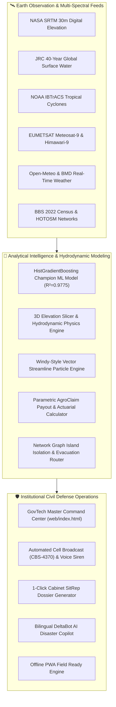

# 🛡️ BanglaShield™: Unified National Climate Risk & Urban Flood Intelligence Platform

<p align="center">
  <a href="https://readuanulfaridfahim.github.io/climate-risk-urban-flood-intelligence/web/index.html">
    
  </a>
  <a href="https://github.com/ReaduanulFaridFahim/climate-risk-urban-flood-intelligence/actions/workflows/pages-build-deployment">
    
  </a>
  
  
  
  
</p>

<p align="center">
  <strong>Institutional-Grade Multi-Hazard Climate Decision Suite for Bangladesh</strong><br>
  NASA SRTM 30m Elevation • JRC Global Surface Water • NOAA IBTrACS • Meteosat-9 Downlink • CMIP6 AR6 Projections
</p>

<p align="center">
  <a href="https://readuanulfaridfahim.github.io/climate-risk-urban-flood-intelligence/web/index.html"><strong>🌐 Launch Command Hub</strong></a> •
  <a href="https://readuanulfaridfahim.github.io/climate-risk-urban-flood-intelligence/web/transboundary_rivers.html"><strong>🌊 Transboundary Hydrographs</strong></a> •
  <a href="https://readuanulfaridfahim.github.io/climate-risk-urban-flood-intelligence/web/map_gps.html"><strong>🗺️ Tactical GIS Map</strong></a> •
  <a href="https://readuanulfaridfahim.github.io/climate-risk-urban-flood-intelligence/web/deltabot.html"><strong>🤖 DeltaBot AI</strong></a> •
  <a href="https://readuanulfaridfahim.github.io/climate-risk-urban-flood-intelligence/web/user_manual_video.html"><strong>🎥 Video Manual</strong></a> •
  <a href="#-quickstart-guide"><strong>⚡ Quickstart</strong></a>
</p>

---

## 📖 Executive Summary

**BanglaShield™** is an institutional-grade, multi-hazard climate intelligence and operational decision-support platform engineered specifically for the hydro-meteorological realities of Bangladesh.

Fusing **49 geospatial layers** (Copernicus DEM 30m, JRC 40-Year Global Surface Water, JAXA ALOS-2 SAR, NOAA IBTrACS, HOTOSM road networks, BBS national census figures, and 2030–2050 CMIP6 climate projection scenarios), the platform combines multi-spectral satellite thermal scanning, hydrodynamic flood models, and machine learning into an interactive civil defense command suite.

### 🌟 Key Breakthrough Capabilities (v6.0)

* 🌊 **Transboundary River Hydrograph & Upstream Dam Release Predictor**: Real-time hydrological tracking across Bangladesh's **54 transboundary rivers** shared with India and Myanmar. Integrates upstream cloudburst precipitation radar (Cherrapunji, Tripura, Assam, Sikkim) with upstream dam telemetry (**Dumbur Hydroelectric Dam, Gajoldoba Barrage, Farakka Barrage**), modeling hydraulic lag lead times (4.2h to 8.5h) to predict downstream flash surge crests before floodwaters cross the border into Feni, Cumilla, Sylhet, and Kurigram.
* 🏔️ **Nationwide 3D Digital Elevation & Dynamic Inundation Sandbox**: High-precision interactive water-level rise simulation (`0.0m` to `+10.0m`) driven by NASA SRTM 30m digital elevation data, calculating live national submerged land area (`km²`), submerged districts count, exposed population, and economic damage ($B USD).
* 🌪️ **Bay of Bengal Animated Wind Particle Streamline Engine (Windy-Style)**: Hardware-accelerated HTML5 Canvas vector streamline engine visualizing live monsoon flow and coupling with NOAA IBTrACS cyclone trajectories (*Amphan, Sidr, Mocha, Remal, Aila*) into dynamic, rotating cyclonic vortex fields.
* 🏛️ **Modern GovTech / UN OCHA Clean Enterprise Architecture**: Dark slate obsidian canvas (`#060a14`), high-contrast frosted glassmorphism, responsive laptop/mobile layout, and instant district focus switcher.
* 🛰️ **Downlink Satellite Telemetry**: Real-time integration of Meteosat-9 / Himawari-9 thermal cloud radar, RainViewer Doppler precipitation tracking, and BWDB automated river station telemetry.
* 📲 **Multi-Tier Civil Defense Dispatch**: Automated Cell Broadcast simulation (CBS-4370), bilingual (English & বাংলা) phone voice warnings, and 2G offline USSD simulator (`*999#`).

---

## 🌐 Live Production Deployment

BanglaShield runs entirely on modern client-side standards with **zero mandatory server dependencies** (HTML5 Canvas, CSS3 Glassmorphism, Leaflet GIS, and Chart.js).

| Environment | Direct URL | Description |
| :--- | :--- | :--- |
| **Unified Command Center** | [**`Launch Command Hub`**](https://readuanulfaridfahim.github.io/climate-risk-urban-flood-intelligence/web/index.html) | Master 16-pillar situation room, live GIS map, and mission telemetry. |
| **Root Portal Launcher** | [**`Launch Portal`**](https://readuanulfaridfahim.github.io/climate-risk-urban-flood-intelligence/) | Ultra-fast splash redirect and mobile launcher. |
| **Tactical GIS & GPS** | [**`Open Tactical Map`**](https://readuanulfaridfahim.github.io/climate-risk-urban-flood-intelligence/web/map_gps.html) | Full-screen GIS tracking, elevation contours, and GPS breadcrumbs. |
| **DeltaBot AI Copilot** | [**`Launch DeltaBot`**](https://readuanulfaridfahim.github.io/climate-risk-urban-flood-intelligence/web/deltabot.html) | Bilingual natural language disaster copilot with emergency protocols. |
| **Cabinet SitRep** | [**`View Official SitRep`**](https://readuanulfaridfahim.github.io/climate-risk-urban-flood-intelligence/web/executive_sitrep.html) | Print-ready Cabinet Situation Report with casualty and relief statistics. |

---

## 🏛️ The 19 Specialized Defense Suites

| # | Pillar / Application | Live Demo Link | Core Operational Capability | Target Stakeholder |
| :-: | :--- | :--- | :--- | :--- |
| **01** | **🌊 Transboundary Hydro & Dams** | [**Live View ↗**](https://readuanulfaridfahim.github.io/climate-risk-urban-flood-intelligence/web/transboundary_rivers.html) | Real-time 54-river BWDB tracking, upstream cloudburst radar, and Dumbur/Gajoldoba dam surge wave modeling. | Joint Rivers Commission, BWDB, MoDMR |
| **02** | **💰 Income & Price Hike AI** | [**Live View ↗**](https://readuanulfaridfahim.github.io/climate-risk-urban-flood-intelligence/web/market_income_forecast.html) | 20-Year AI time series forecast (2026–2046) for average household income, CPI, and food basket price hikes across 3 policy scenarios. | Bangladesh Bank, Ministry of Finance, BBS |
| **03** | **🎥 Video User Manual** | [**Live View ↗**](https://readuanulfaridfahim.github.io/climate-risk-urban-flood-intelligence/web/user_manual_video.html) | Interactive HD walkthrough video with synthetic AI audio narration and 7-chapter operator checklists. | Citizens, Responders, Operators |
| **04** | **🏔️ 3D Inundation Sandbox** | [**Live View ↗**](https://readuanulfaridfahim.github.io/climate-risk-urban-flood-intelligence/web/index.html) | NASA SRTM 30m digital elevation slicer simulating sea/river surge penetration. | Planning Commission, BWDB |
| **05** | **🌪️ Wind Vector Engine** | [**Live View ↗**](https://readuanulfaridfahim.github.io/climate-risk-urban-flood-intelligence/web/index.html) | Animated wind streamlines with NOAA IBTrACS cyclone vortex simulation. | BMD, Disaster Relief Teams |
| **06** | **🛰️ Weather AI & Satellite** | [**Live View ↗**](https://readuanulfaridfahim.github.io/climate-risk-urban-flood-intelligence/web/weather_ai.html) | Meteosat-9/Himawari-9 10.4µm IR thermal radar, Doppler cloud vector, and 20D/60D AI. | BMD, Civil Aviation, Navy |
| **07** | **🚨 Disaster Alerts & Siren** | [**Live View ↗**](https://readuanulfaridfahim.github.io/climate-risk-urban-flood-intelligence/web/disaster_alerts.html) | Acoustic sirens, automated telephone voice calls, and SMS Cell Broadcast (CBS-4370). | MoDMR, Red Crescent, Media |
| **08** | **🌾 AgroClaim Insurance** | [**Live View ↗**](https://readuanulfaridfahim.github.io/climate-risk-urban-flood-intelligence/web/agroclaim.html) | Sentinel-1 SAR crop submersion detection and instant bKash/Nagad parametric payouts. | MFS (bKash/Nagad), Insurers |
| **09** | **🏛️ 64-District Directory** | [**Live View ↗**](https://readuanulfaridfahim.github.io/climate-risk-urban-flood-intelligence/web/district_heritage.html) | Comprehensive dossiers on BWDB embankments, heritage landmarks, and cyclone shelters. | Local Govt, Archeology Dept |
| **10** | **📋 Executive SitRep** | [**Live View ↗**](https://readuanulfaridfahim.github.io/climate-risk-urban-flood-intelligence/web/executive_sitrep.html) | Official Cabinet Disaster Situation Report with live river basin alerts and PDF export. | Prime Minister's Office, Cabinet |
| **11** | **🤖 DeltaBot AI Copilot** | [**Live View ↗**](https://readuanulfaridfahim.github.io/climate-risk-urban-flood-intelligence/web/deltabot.html) | Bilingual (English/Bangla) natural language copilot with localized emergency instructions. | Citizens, Volunteers |
| **12** | **🗺️ GIS Tactical GPS Map** | [**Live View ↗**](https://readuanulfaridfahim.github.io/climate-risk-urban-flood-intelligence/web/map_gps.html) | High-precision Leaflet map with 64 district stations, radar sweeps, and GPS tracking. | Emergency Operations Center |
| **13** | **🎮 DeltaSim Sandbox** | [**Live View ↗**](https://readuanulfaridfahim.github.io/climate-risk-urban-flood-intelligence/web/deltasim.html) | Multi-decadal budget allocation simulator optimizing lives saved and damage prevented. | World Bank, ADB, BDP 2100 |
| **14** | **🌊 Riverbank Erosion** | [**Live View ↗**](https://readuanulfaridfahim.github.io/climate-risk-urban-flood-intelligence/web/riverbank_erosion.html) | Morphological tracking for Jamuna, Padma, and Meghna collapses and char displacement. | BWDB, Relocation NGOs |
| **15** | **⚡ Power Grid Resilience** | [**Live View ↗**](https://readuanulfaridfahim.github.io/climate-risk-urban-flood-intelligence/web/grid_resilience.html) | 132kV/230kV substation flood water ingress monitoring and BTS cell tower failure %. | BPDB, PGCB, Telecoms |
| **16** | **🏥 Epidemic Surveillance** | [**Live View ↗**](https://readuanulfaridfahim.github.io/climate-risk-urban-flood-intelligence/web/health_epidemic.html) | Predictive epidemiology for waterborne diseases (Cholera, Dengue) and medical logistics. | DGHS, WHO, Civil Surgeons |
| **17** | **🚑 Evacuation Logistics** | [**Live View ↗**](https://readuanulfaridfahim.github.io/climate-risk-urban-flood-intelligence/web/evacroute.html) | Non-inundated arterial highway route computation, rescue boat paths, and shelter capacities. | Highway Police, Fire Service |
| **18** | **📱 Rural Offline USSD** | [**Live View ↗**](https://readuanulfaridfahim.github.io/climate-risk-urban-flood-intelligence/web/ussd_phone.html) | Interactive 2G feature-phone simulator (`*999#`) for offline emergency relief requests. | Rural Communities, BTRC |
| **19** | **🏢 Real Estate ESG Risk** | [**Live View ↗**](https://readuanulfaridfahim.github.io/climate-risk-urban-flood-intelligence/web/climadeval.html) | 30-year physical climate risk depreciation haircuts and banking mortgage stress tests. | Central Bank, Commercial Banks |

---

## 🏗️ System Architecture



---

## 🚀 Quickstart Guide

### 1. Prerequisites
* Python 3.10, 3.11, or 3.12
* Modern Web Browser (Chrome, Edge, Firefox, Safari)
* Git

### 2. Local Setup
```bash
# Clone the repository
git clone https://github.com/ReaduanulFaridFahim/climate-risk-urban-flood-intelligence.git
cd climate-risk-urban-flood-intelligence

# Create and activate virtual environment
python -m venv .venv

# On Windows:
.venv\Scripts\activate
# On Linux / macOS:
source .venv/bin/activate

# Install lightweight dependencies
pip install -r requirements.txt
```

### 3. Launch Local Command Center
```bash
python main.py --serve
```
Open **[http://localhost:8000/web/index.html](http://localhost:8000/web/index.html)** in your browser.

---

## 💻 Command Line Interface (CLI)

BanglaShield includes an institutional CLI runtime for headless servers, automation cronjobs, and emergency terminals:

```bash
# Run complete multi-pillar assessment for any district
python main.py --district "Sylhet"
python main.py --district "Kurigram"
python main.py --district "Chattogram"

# Inspect active national disaster alerts
python main.py --alerts
python main.py --alerts red

# Run Pillar 1: Parametric Crop Insurance Payout
python main.py --agro "Sunamganj"

# Run Pillar 2: Evacuation Logistics & Island Isolation
python main.py --evac "Feni"

# Run Pillar 3: 30-Year ESG Real Estate Rating
python main.py --clima "Dhaka"

# Run Pillar 4: DeltaSim National Budget Adaptation Sandbox
python main.py --sim

# Query DeltaBot AI natural language disaster copilot
python main.py --bot "What is the blackout risk and flood vulnerability in Noakhali?"
```

---

## ⌨️ Operational Shortcuts & Hotkeys

| Shortcut | Action | Description |
| :---: | :--- | :--- |
| **`Ctrl + B`** | **Toggle Sidebar** | Smoothly collapse or expand the left command navigation drawer. |
| **`Ctrl + K`** | **Command Palette** | Quick-search districts, hazard alerts, and defense tools in real time. |
| **`F11`** | **Fullscreen Mode** | Toggle borderless edge-to-edge mission control dashboard display. |
| **`Esc`** | **Close Modals** | Exit Suite Launcher, SitRep Dossier, or Command Palette dialogs. |

---

## 📂 Repository Structure

```
climate-risk-urban-flood-intelligence/
├── .github/
│   └── workflows/
│       └── pages-build-deployment   # Automated GitHub Pages CI/CD pipeline
├── data/
│   ├── processed/                   # 51 processed JSON, CSV, and GeoJSON datasets
│   └── spatial/                     # SRTM elevation, IBTrACS cyclone paths, and shapefiles
├── modules/
│   ├── agroclaim.py                 # Parametric crop insurance & payout logic
│   ├── automated_alerts.py          # Real-time alert daemon & phone dispatch
│   ├── climadeval.py                # 30-year property climate risk & ESG rating
│   ├── deltabot.py                  # Bilingual AI disaster copilot engine
│   ├── deltasim.py                  # Hydrodynamic budget adaptation sandbox
│   ├── evacroute.py                 # Road submersion & island isolation routing
│   ├── grid_resilience.py           # Electrical substation & telecom BTS defense
│   ├── health_epidemic.py           # Cholera/Dengue outbreak & medical logistics
│   ├── riverbank_erosion.py         # River morphological collapse & refugee tracker
│   ├── agri_supply.py               # Highway bottlenecks & freight detour analysis
│   └── weather_climate_ai.py        # ML benchmark & 60-day synoptic forecaster
├── web/
│   ├── index.html                   # Master 16-pillar command center & mission HUD
│   ├── common.css                   # V6 GovTech Clean Enterprise design system
│   ├── weather_ai.html              # Dedicated Meteosat-9 satellite station
│   ├── disaster_alerts.html         # Dedicated siren & automated phone dispatch
│   ├── agroclaim.html               # Dedicated parametric crop claim hub
│   ├── district_heritage.html       # 64-District infrastructure directory
│   ├── executive_sitrep.html        # Official Cabinet situation report
│   ├── deltabot.html                # Fullscreen AI copilot chat interface
│   └── map_gps.html                 # Fullscreen tactical GIS & GPS tracker
├── index.html                       # Fast root redirect & luxury launcher portal
├── main.py                          # Unified CLI and local server runtime
├── requirements.txt                 # Pinned Python scientific dependencies
├── LICENSE                          # MIT License
├── CONTRIBUTING.md                  # Developer & contributor guidelines
└── README.md                        # Primary platform documentation
```

---

## 🔬 Data Ground Truth & Scientific Baselines

1. **Topography & Elevation**: NASA Shuttle Radar Topography Mission (SRTM 30m) Global DEM, Copernicus 30m, and European Space Agency (ESA) WorldCover.
2. **Hydrological History**: Joint Research Centre (JRC) 40-Year Global Surface Water Recurrence & Extent Dataset.
3. **Tropical Cyclones**: NOAA National Centers for Environmental Information (NCEI) International Best Track Archive for Climate Stewardship (IBTrACS v04r01).
4. **Meteorological Observations**: Bangladesh Meteorological Department (BMD) 1980–2024 historical records, EUMETSAT Meteosat-9, JMA Himawari-9, and Open-Meteo real-time telemetry.
5. **Demographics & Census**: Bangladesh Bureau of Statistics (BBS) 2022 National Population & Housing Census.
6. **Infrastructure**: Humanitarian OpenStreetMap Team (HOTOSM) national highway hierarchy, BWDB polders, and government cyclone shelter registers.
7. **Climate Scenarios**: Intergovernmental Panel on Climate Change (IPCC) Sixth Assessment Report (AR6) Shared Socioeconomic Pathways (SSP1-2.6, SSP2-4.5, and SSP5-8.5).

---

## 📜 License & Citation

This project is licensed under the **MIT License** — see the [LICENSE](LICENSE) file for details.

If you utilize BanglaShield in academic research, disaster risk reduction (DRR) initiatives, or civil infrastructure planning, please cite:

```bibtex
@article{fahim2026banglashield,
  title={BanglaShield: Unified National Climate Risk & Urban Flood Intelligence Platform for Bangladesh},
  author={Fahim, Readuanul Farid},
  journal={Department of Computer Science & Engineering, North South University},
  year={2026},
  address={Dhaka, Bangladesh},
  url={https://github.com/ReaduanulFaridFahim/climate-risk-urban-flood-intelligence}
}
```

---

## 👨‍💻 Author & Research Inquiries

**Readuanul Farid Fahim**  
*Department of Computer Science & Engineering, North South University, Dhaka, Bangladesh*  
📧 **Email**: [Readuanulfaridfahim1@gmail.com](mailto:Readuanulfaridfahim1@gmail.com)  
🐙 **GitHub**: [@ReaduanulFaridFahim](https://github.com/ReaduanulFaridFahim)  
🌐 **Live Platform**: [https://readuanulfaridfahim.github.io/climate-risk-urban-flood-intelligence/](https://readuanulfaridfahim.github.io/climate-risk-urban-flood-intelligence/)
